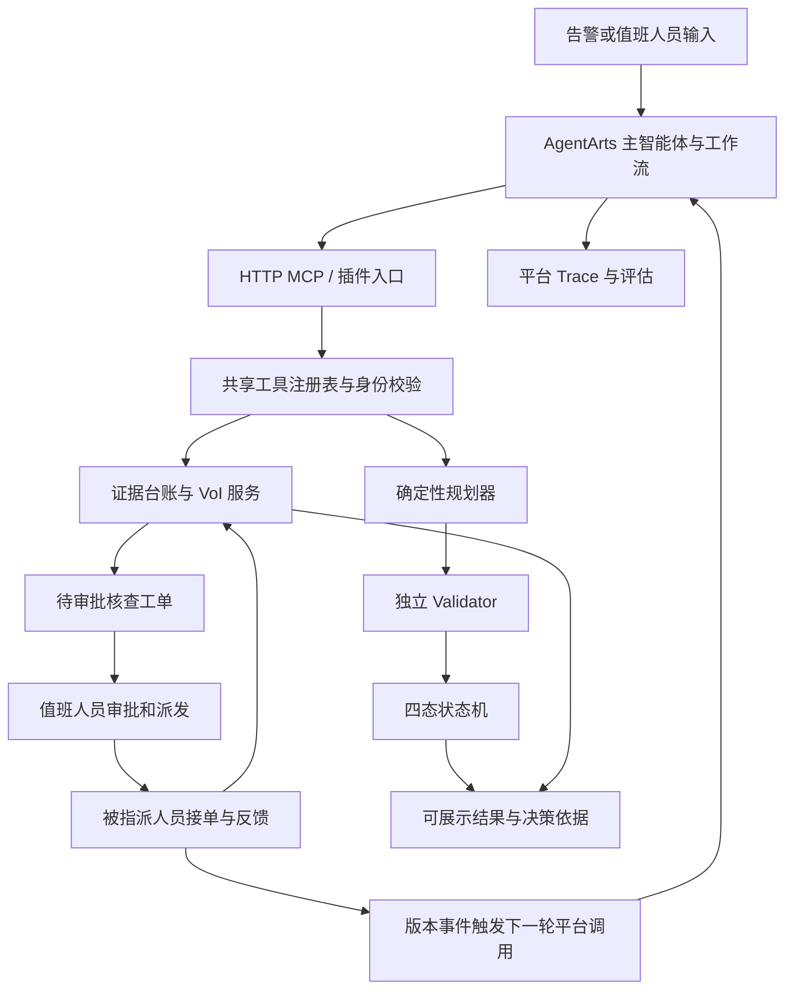

# SkyGuard：第十一届华为 ICT 创新赛 AgentArts 赛题改进方案

编制日期：2026-11-05。输入条件：3 名队员、30 天；用户确认可使用真实 AgentArts 租户，并可联系场馆人员开展访谈或受控演练。

基线：当前工作区，Git HEAD 为 3b62fe9，包含已有未提交修改；收尾时纳入了工作区新产生的 V6.2 报告。本文件是设计与执行计划，尚未实施其中的新增能力；引用的实验结果来自已有仓库产物，本次没有重新运行实验。研究假设登记见 [CLAIMS.md](../research/CLAIMS.md)。

## 1. 决策：把主线收敛到“有限资源下的主动核查与人员协同”

建议项目名称：**SkyGuard——基于 AgentArts 的大型活动主动核查与人员协同辅助决策**。

一句话说明：**两处告警、一个失效摄像头、一名可用巡查员，系统帮助值班人员决定先核查哪里，把核查依据、人工审批和现场反馈连成可追溯的闭环。**

现有安全内核值得保留。未来 30 天的主要增量是让真实 AgentArts 承担业务编排，用实际场馆工作流程检验价值，并补齐实验的可比性。比赛结果还取决于评审、竞争队伍和现场表现，无法保证国家一等奖；本计划针对可控制的参赛质量与证据完整性。

交付范围限定为一个活动散场场景、一个真实协作场地、一条完整平台链路，以及少量可复现的异常分支。项目性质继续保持“研究原型 / 辅助决策”。

30 天必须形成四份核心成果：

1. **真实平台成果**：AgentArts 已发布应用、实际调用记录、工具调用链、人工审批后续接与评估记录。
2. **真实需求成果**：场馆人员确认的工作流程、受控任务记录、基线流程与使用原型后的对照。
3. **技术成果**：在相同资源、时间和观测条件下检验主动调查；保留独立校验、四态与权限边界。
4. **参赛成果**：可运行部署、可复现代码、原始证据、技术报告、演示视频与答辩材料。

## 2. 赛事依据与时间安排

用户已确认目标为**第十一届华为 ICT 大赛创新赛，赛题 2：基于华为云 AgentArts 智能体开发平台的 Agent 设计和应用**，不是中国国际大学生创新大赛的同名产业赛题。

大连理工大学发布的赛事通知列出：2026-11-30 报名截止、2026 年 12 月初赛、2027 年 3 月中国总决赛、2027 年 5 月全球总决赛；同时说明队伍由同校 3 名学生和 1 名指导教师组成，并要求提交内容可复现。这里采用高校正式通知作为当前排期依据，具体提交截止、评分细则和最新变更仍以组委会为准。[赛事通知](https://chuangxin.dlut.edu.cn/info/1020/16867.htm)

**尚未核验：本届赛题 2 各阶段的具体评分权重、材料格式与演示时长。** 官方赛事页为动态页面，本次未能读取其完整规则正文；不能把校赛分值、往届权重或赛题 1 的权重套进来。[华为赛事入口](https://e.huawei.com/cn/talent/ict-academy/#/ict-contest?compId=85132018)

若从 2026-11-05 开始，D30 为 2026-12-04，晚于上述报名截止。因此安排：D1 核对报名与指导教师，D24（11-28）形成可提交包，D26（11-30）前完成报名要求，余下时间用于稳定性和答辩。报名日期不能被当作作品提交日期，D1 必须分别确认。

以下是团队的交付优先级映射，**不是官方评分表**：

| 需要回答的问题 | 现有基础 | 30 天补充证据 | 优先级 |
| --- | --- | --- | --- |
| 是否真实基于 AgentArts 开发和运行 | HTTP 模板与本地契约测试 | 已发布应用、真实调用、MCP、Trace、评估 | P0 |
| 是否解决具体用户问题 | 合成体育场流程 | 访谈、流程图、现场任务记录、用户反馈 | P0 |
| 是否有可验证的技术增量 | VoI、校验器、工单上下文版本 | 等资源等时限实验、强基线、失败案例 | P0 |
| 是否完整可用且可复现 | API、大屏、staff 页面、测试 | 云端与移动端闭环、重启/断网演示、部署复现 | P0 |
| 是否有推广依据 | JSON 场景化设计 | 第二配置的迁移检查、每场部署工作量 | P1 |

## 3. 当前方案审查：先修复会削弱答辩可信度的问题

现有优势包括独立 Validator、四态状态机、角色分权、工单幂等与 stale 检查、共享工具实现、预测滚动评估和实验原始数据。已有发布记录列出后端 104、前端 8 个测试通过；这属于仓库已有记录，不代表本次重新验证。[发布记录](RELEASE_CHECKLIST.md)

| 问题 | 当前证据 | 对参赛的影响 | 建议改动 |
| --- | --- | --- | --- |
| AgentArts 接入依据过时 | [接入文档](AGENTARTS_INTEGRATION.md) 仍称未找到公开 API | 容易把已可解决的接入问题当作外部阻塞 | 按真实租户版本更新契约、鉴权、调用路径及文档 |
| 远程运行只调用一次工具 | [index.ts](../backend/src/services/mvp/index.ts) 的 runWithAgentArts | 无法展示完整调查、等待反馈和再决策 | 改为有界多步流程，并能在审批/反馈后续接 |
| HTTP 健康成功就标记 CONNECTED | [agentarts.ts](../backend/src/services/mvp/agentarts.ts) 的 healthCheck | 连通性不足以证明业务链路已运行 | 分开显示连通、最近成功调用、完整闭环验证时间 |
| MCP 当前为独立 stdio 进程 | [server.ts](../backend/src/mcp/server.ts) | 接上云端仍需处理网络传输与业务状态一致性 | HTTP 入口复用 Web API 的同一个服务实例和工具注册表 |
| 场景未完全移出代码 | agentarts.ts 写死 stadium-evacuation；index.ts 演示分支含 R_EAST_STAND 等 | 与项目“场景是数据”约定不一致，换场馆会失败 | 场景 ID 从配置传入，演示序列移到场景 JSON |
| VoI 覆盖权重仍有代码默认值 | [multi-voi.ts](../backend/src/services/mvp/multi-voi.ts) 中 neighbor/global 默认 0.5/0.3 | 参数来源不可完整追溯 | 参数显式进入场景 Schema、版本与 provenance；缺失时明确报错 |
| 预算只检查已消耗量 | multi-voi.ts 检查 usedCost/usedTime，未按每个候选动作预检执行后是否超限 | 最后一项动作可能突破预算 | 对资源、时间、动作数逐项检查 used + candidate <= limit |
| 多区域对照的观测权限不一致 | [v61-benchmark.ts](../backend/scripts/v61-benchmark.ts) 与 [v62-benchmark.ts](../backend/scripts/v62-benchmark.ts) 中 single 强制只更新 target，其他策略按覆盖范围更新 | 收益混合了选取策略与观测范围的差异 | 物理动作覆盖由环境统一决定，所有策略同等获得该动作的证据 |
| 实验观测过于理想化 | 两版脚本的 outcomeFor 选最大似然结果，runFairTrial 总记录 success: true | 缺少真实随机误差、失败与延迟 | 环境按似然采样，并加入失败、重复来源、延迟和参数错配 |
| 效率结论对实验设计敏感 | [V6.1](../evaluation/V6_1_REPORT.md) 效率差 CI 包含 0；[V6.2](../evaluation/V6_2_REPORT.md) 目标轮换后效率差 +0.0917，CI [0.0755, 0.1079] | 不能单列总收益倍数，也不能忽略 V6.2 的条件性正结果 | 两版并列报告；新实验统一观测权限与资源/时间约束 |
| 同预算重试优势不成立 | V6.1 中两组成功率均为 92% | 不应继续列为已经证明的算法创新 | 保留为可靠性机制，移出“提高成功率”的主张 |
| 数据与报告还需校准 | 感知无真实标注；预测部分区间欠覆盖；竞赛报告出现案例数 undefined | 评委会质疑效果和材料一致性 | 采集小规模独立数据；修复生成脚本与说明，不手改 raw 数据 |

V6.2 已增加 30 个种子、1,200 对多区域样本和目标轮换。其收益约 4.6 倍、成本约 2.3 倍，并报告条件性效率提升；这些统计与复现工作可直接复用。下一轮的重点是观测模型与对照公平性，增加种子数量不能消除这些设计问题，也不能据上述两版差异单独断言某一个因素的因果作用。

这些是静态代码与已有报告审查结论。修复时需要针对相应行为复现与回归，不把这一表当作已经完成的修复报告。

## 4. 产品与 AgentArts 架构

### 4.1 主场景与用户

主用户是场馆值班负责人，协作用户是巡查/疏导人员。场馆已有电话、对讲或群消息流程作为人工基线。首个产品目标为“从告警出现到获得可用现场证据、形成可审批处置建议”的闭环，效果衡量聚焦操作耗时、遗漏、重复核查和任务完成。

建议在同一场馆选择可管理的小范围试验区域，开展桌面演练或低密度走位任务。真实场馆身份、区域数量和空间参数由现场资料确定，不能从合成体育场直接改名冒充。全场容量、灾害推演和真实疏散效果不作为这 30 天的验证对象。

### 4.2 主路径

所有安全约束仍由代码计算。AgentArts 负责理解任务、调用工具、组织证据、生成引用充分的解释，并管理多步业务流程；不能编造人数、概率、容量、VoI 分值或更改校验结果。

默认采用**一个主智能体 + 确定性工作流**。只有主路径稳定且对照证据表明有价值时，再增加“只读场馆规程助手”；不把增加 Agent 数量当作创新指标。现场执行者是工作人员，不能由另一个 LLM 扮演已完成执行的人员。

### 4.3 平台能力对应具体成果

| 平台能力 | SkyGuard 的用途 | 必须保留的证据 |
| --- | --- | --- |
| 已发布 Agent / 工作流 | 告警解析、调查编排、人工等待后的续接 | 应用版本、部署标识、导出资产或创建步骤 |
| 自定义 MCP 或 API 插件 | 调用现有工具与新增调查评分工具 | 工具 Schema、实际调用参数、返回值和错误 |
| 场馆规程引用 | 对建议附上适用规程的版本与出处 | 经场馆确认的文本、命中片段；P1 才扩展知识库 |
| 调用链与观测 | 展示一次业务如何经历工具、审批与反馈 | 平台会话/请求 ID 与本地 run_id/work_order_id 映射 |
| 离线评估 | 比较不同编排或提示词版本 | 固定评测集、运行配置、失败样例与原始输出 |

华为官方已有自定义 MCP、应用调用 API、调用链分析与评估文档，因此“没有公开资料”不再是合理的接入结论。具体功能仍须在用户租户及其区域验证。[MCP 服务](https://support.huaweicloud.com/lowcode-agentarts/agentarts_05_0021.html)、[调用 API](https://support.huaweicloud.com/api-agentarts/InvokeRuntime.html)、[轨迹分析](https://support.huaweicloud.com/ops-agentarts/agentarts_14_0145.html)、[评估指南](https://support.huaweicloud.com/helppanel-agentarts/agentarts_20_0019.html)

### 4.4 接入实现原则

- 当前公开 API 的调用路径形式为 POST /runtimes/{runtime_name}/invocations；已有模板 /v1/agents/{agent_id}/invoke 不能直接当成官方契约。实际 endpoint、runtime_name、输入变量、鉴权与返回模式以租户发布页为准。[API 文档](https://support.huaweicloud.com/api-agentarts/InvokeRuntime.html)
- 官方 API Key 示例包含 Bearer 凭证与 x-hw-agentarts-session-id；工作流输入字段取决于开始节点定义，用户代码托管应用也有自己的请求契约。两类格式分别验证，不能只替换 URL。[API Key 调用示例](https://support.huaweicloud.com/api-agentarts/agentarts_07_0035.html)
- 首选一个远程 Streamable HTTP MCP 入口，挂接当前后端服务实例；如果该租户实际连接方式不同，则使用官方 API 插件桥接同一个 ToolRegistry。不能另起 stdio 服务后让它与网页各自维护一套工单和观测状态。[自定义 MCP 接入](https://support.huaweicloud.com/lowcode-agentarts/agentarts_05_0136.html)
- 新增工具建议为 evaluate_investigation_options、get_evidence_history，仍统一定义角色、Schema、超时与审计。评分结果必须来自代码，LLM 只能引用。
- 云端服务身份固定映射为 agent。角色、staff_id、审批权限不能从模型参数或自然语言中取得；审批与现场反馈继续由现有受鉴权的人工接口承担。
- 长时间人工等待通过持久化业务会话续接：存储 run_id、context_version、待处理工单、已完成步骤与幂等键；收到经鉴权的业务事件后重新调用平台。平台会话 ID 不能替代本地业务状态。
- 为“创建工单已成功但网络超时”设计查询与幂等恢复；同一业务动作不得因模型重试创建多个工单。审批状态变化、反馈事件和续接任务需要防重复处理。
- 复用现有工单快照，补足会话与幂等记录；默认单服务实例。若现有快照无法保证重启恢复，则在有限范围内将工单、会话和事件处理记录放入同一事务存储，先证明单实例行为，不扩展分布式系统。

Agent 运行状态建议补充 WAITING_APPROVAL、WAITING_EVIDENCE、COMPLETED、FAILED 等，与安全四态分开。**平台故障不自动等同于感知 DEGRADED**；安全四态仍由安全内核按数据与约束推导。

### 4.5 界面只强化当前任务所需的信息

沿用现有 React 与 staff 页面，增加一张可展开的“决策依据”卡：当前缺什么证据、候选核查动作、预计占用的时间/人员、推荐原因、下一位责任人、当前审批状态。来源与时间一眼可见，详细 Trace 放入展开区。

同屏显示三个独立维度：安全状态、Agent 业务进度、平台运行状态。stale 工单突出“需重新确认”，DEGRADED 不显示有效路线；一个区域补证成功不能解除其他区域的数据缺口。管理员在桌面审批，工作人员在手机接单反馈，完成后大屏真实更新。避免为了演示在前端写死成功、人员状态或统计数字。

## 5. 技术增量：时间与资源约束下的主动补证

### 5.1 保留已有 VoI，增加有明确意义的约束

原有 Bayesian VoI 已经包含期望损失降低、信息增益和成本。它是方法基础，不能把标准贝叶斯更新重新命名为原创算法。建议研究增量聚焦：**证据会重复、会过期，核查也会占用有限人员与时间，系统如何决定何时调查、调查哪里和何时转人工。**

第一版算法继续使用原有可解释评分，增加三项机制：

1. **执行前预算约束**：每个候选动作必须同时满足剩余人员可用性、资源预算、动作数与截止时间；不能等到下一轮才发现已超预算。
2. **证据新鲜度与去重**：同一观测 ID 不更新两次；同源相邻视频帧不当成多个独立证据。没有相关性模型时，同组证据优先使用最新有效记录，并明确尚未做完整相关推断。
3. **基于新证据续接**：请求现场核查只创建待审批任务；只有返回的新证据通过来源、角色、时效与结构检查后，才更新信念并重新评估。申请成功不等于核查完成。

这些机制的增量价值必须用对照实验检验。若在公平比较中没有提升，就保留为工程可靠性改进，不能声称新算法优越。

### 5.2 证据记录与参数来源

新增证据结构的最小字段：

| 字段 | 用途 |
| --- | --- |
| evidence_id、source_type、source_id | 标识与去重，区分人工、视频、合成回放 |
| observed_at、received_at、expires_at | 区分观测时间、接收时间与有效期 |
| scenario_id、region_id、context_version | 对应场景及计算上下文 |
| source_group、supersedes_id | 关联同源或被替代的观测 |
| payload、calibration_version、provenance | 保存测量值、标定依据和来源说明 |
| work_order_id、actor_id、trace_id | 对应现场任务、身份和平台链路 |

来源真实不代表测量准确。人工记录仍可为估计值；视频置信度不自动等于真实准确率。冲突记录先标为待核验，不能靠 LLM 选择一个喜欢的数值。

先验、似然、损失、权重、覆盖系数、时效和预算配置统一进入 data/scenarios/*.json 与对应 Schema；更新 [VOI_MODEL.md](VOI_MODEL.md)。行动时长可来自受控任务记录，损失矩阵由场馆人员解释管理偏好；小样本无法可靠估计的概率继续标为估计值，并进行敏感性分析。

### 5.3 重做实验的环境层

环境与策略分离。一次物理核查能观察哪些区域、何时返回、是否失败，由统一环境决定；任何策略选择相同动作都获得同分布的观测。各策略共享初始状态、动作库、真实隐藏状态与配对随机环境，但只能看到自己实际执行动作后可获得的信息。

环境按似然分布采样观测，不能选择最大概率标签当作每次真实结果。使用按场景、动作、区域和尝试编号索引的随机源，避免策略调用顺序不同导致配对失效。重复观测相关性与动作失败须显式模拟；另设“环境参数与策略参数不完全相同”的压力组，避免策略只在自己的假设生成器上获胜。

主指标使用隐藏真值下的决策损失或专家独立制定的任务判定；模型内部的后验风险下降、熵下降只作诊断指标。分母很小时的收益/成本比不能作为唯一结论。

## 6. 用四组实验建立可审查的证据

所有样本数与目标均为**计划值**，不是已取得的成绩。D3 先写实验协议，完成小规模 pilot 后冻结数据划分和指标，再开展最终评估；不能看完测试结果后反复调参数。

### E1：真实 AgentArts 能否完成任务

准备 40 个不重叠任务实例，每例重复 3 次，计划 120 次真实运行。覆盖正常查询、信息缺口、证据冲突、工具失败、审批等待、上下文变化；任务实例与最终盲测集分开，不把同一文本换词当成独立样本。

对照为同一租户、同一模型、同等工具权限和调用预算的普通 Agent 工作流；本地确定性流程作为额外参考，不故意删掉它已有的工具。完成判据从 API 状态、工具回执与工单记录检查，不能由模型给自己打分。报告任务完成率、错误工具调用、越权尝试的阻断情况、重复工单、续接成功及各类失败数。

平台的 LLM 评估可辅助分析表达质量与轨迹，不能替代后端角色校验、状态机检查或独立 Validator。真实运行次数未达到计划时如实报告 n。

### E2：主动调查是否值得使用

比较四种策略：现有可用的固定巡查策略、成本感知的贪心策略、现有 VoI、带新鲜度/去重/时限约束的 VoI。资源充足时可加离线枚举最优解作小规模参考上界；它不能获得比其他策略更多的真实观测，若使用先知信息则只能作为明确标记的理论上界。

计划 30 个种子 × 每种子 20 个 trial × 6 类预注册条件，共 3,600 个配对环境、4 策略共 14,400 条结果。六类条件为基本、紧预算、紧时限、观测低质量、重复/冲突证据、工具失效；参数值由场景配置定义。复用 V6.2 的种子组织、原始记录和统计工具，新增工作集中于环境隔离、预算一致和新机制消融。

每组使用相同资源上限、相同时间上限、相同可选动作和观测规则；允许提前停止，实际消耗单独报告，不强行花完预算。指标为期限内有效核查率、真实状态下的决策损失、人员分钟数、最坏区域结果、失败率及成本收益曲线。区间按配对 trial 和种子结构计算，不把帧或同一任务的多次工具调用当独立样本。

消融一次仅去掉一个新增机制；小规模重复证据和超预算反例必须保留。内部期望是在不增加漏核查与错误建议的条件下减少无效调查；若置信区间包含无改进，不宣称总体优越。

### E3：场馆人员是否真正节省工作

先访谈 3–5 位值班/巡查人员，记录当前如何发现、核实、派发和回报，取得他们确认的流程与痛点。计划招募 8 位符合任务条件的参与者，每人完成 6 个任务，合计 48 次受控任务；若实际人数更少，按实际记录，这是探索性研究。

人工原流程与原型流程采用等价任务、随机顺序与交叉平衡，减少熟悉案例带来的学习偏差。每人分别体验两种流程，场馆负责人或独立观察者判定任务结果；记录时间、遗漏、重复沟通和操作错误。不能把团队开发者自己演熟的流程代替用户评估。

将“中位任务完成时间减少 20%”设为预先声明的产品期望值，同时检查遗漏和错误是否上升。它不是效果承诺或获奖门槛。报告配对差值与参与者层面的区间；8 位参与者不足以推导广泛行业结论。

区分三类数据：场馆真实日常记录、在真实场地实施的受控任务、合成故障注入。容量与概率未实测时继续标为估计，不把受控走位称作大型疏散演练。短期不训练新视觉模型；优先把人工核实记录和已有可合法使用的回放接入统一证据链。

### E4：失败时能否保持一致行为

在保留现有安全测试的基础上，增加与真实平台链路有关的必要回归：

- Agent 试图冒充管理员、工具参数包含越权身份、规程文本夹带忽略限制的指令。
- 工单创建后响应丢失、重复回调、反馈先到/审批后到、平台调用超时。
- 审批后观测或约束变化、人员已被其他任务占用、旧证据过期。
- 后端重启后恢复待处理会话、平台不可用但人工流程仍可操作。
- 未知通道/容量进入候选方案、Validator 拒绝、DEGRADED 不展示可用路线。

计划不少于 60 个固定故障用例，按类列分母、检出数、未完成任务和人工处理结果。该集合中不允许未授权派发、重复工单生效或错误展示已验证路线；发现任一问题即修复并重跑受影响集合。样本中零次错误不能表述为现实世界零风险。

### 证据保存与性能口径

拟新增 evaluation/agentarts/、evaluation/field-pilot/、evaluation/voi-v2/，分别保存真实平台、受控用户研究与模拟实验原始数据；通过现有 manifest 工具登记哈希与生成方式。平台 Trace 脱敏后保留，可公开复现的配置与受限现场材料分开管理。

记录 Git 版本、未提交差异标识、场景/模型/提示词/工作流版本、数据划分、随机种子、请求 ID 与计费记录。系统性能数字仍只通过 npm run bench 的实测产物对外发布；若需要平台时延，在该基准入口增加显式远程测试配置，保留原始 JSON。人工等待耗时单独报告，不混进规划器毫秒级性能。

## 7. 三人 30 天执行表

按每人每天约 5 小时有效投入估算，总容量 450 小时。安排 360 小时具体工作，预留 90 小时处理平台接入、现场排期和故障。若实际可用工时更少，先删 P1，保留 P0 闭环。

角色分工：A 负责平台/后端集成，B 负责 VoI/安全/实验，C 负责场馆/前端/演示。人员姓名由团队映射，下面的分工不是额外招聘要求。

| 时间 | A：平台与后端 | B：算法与证据 | C：场馆与体验 | 阶段产物 |
| --- | --- | --- | --- | --- |
| D1–D3，11-05～11-07 | 核对官方规则、租户与区域，真实调用一个只读工具 | 冻结现状，复现预算/观测范围问题，起草实验协议 | 确认指导教师、报名状态、场馆联系人并完成首轮访谈 | 真实调用回执、场景范围、任务清单 |
| D4–D7，11-08～11-11 | HTTP MCP 接入同一服务，建立平台主流程 | 场景硬编码迁移、候选预算预检、参数 Schema | 手机审批/反馈联调，安排受控任务采集 | 平台→待审批→人工→反馈的首个完整闭环 |
| D8–D14，11-12～11-18 | 会话续接、幂等恢复、关联 Trace | 证据去重/时效与公平环境实现，小样本 pilot | 真实场地资料与任务记录，决策依据卡 | 数据 v1、实验协议冻结、第一轮用户反馈 |
| D15–D21，11-19～11-25 | 固定模型/工作流版本，故障与恢复测试 | 正式对照、消融、置信区间与失败分析 | 交叉任务评估，录制真实平台与手机流程 | 主要实验报告、冻结功能范围 |
| D22–D24，11-26～11-28 | 新环境部署复现，验证提交版本 | 主张逐项核对原始数据，修正文档生成器 | 完成技术报告、作品说明和演示视频 | 可提交版本、材料目录、复现说明 |
| D25–D30，11-29～12-04 | 解决稳定性问题，保留可用部署 | 交叉答辩审查、追查失败用例 | 演示与追问演练，完成报名/提交检查 | 冻结演示版本、故障备用演示与答辩材料 |

工时预算用于避免把每项任务都当成“顺手完成”：

| 工作包 | A 小时 | B 小时 | C 小时 | 合计 |
| --- | ---: | ---: | ---: | ---: |
| 规则、基线和契约核对 | 8 | 8 | 8 | 24 |
| 真实 AgentArts 与 MCP 集成 | 64 | 8 | 8 | 80 |
| 业务续接、证据与权限一致性 | 24 | 24 | 8 | 56 |
| VoI 与公平评测环境 | 4 | 40 | 4 | 48 |
| 场馆任务与界面 | 4 | 8 | 44 | 56 |
| 实验、故障验证和复现 | 8 | 32 | 20 | 60 |
| 材料与演示 | 8 | 0 | 28 | 36 |
| 已安排 | 120 | 120 | 120 | 360 |
| 机动 | 30 | 30 | 30 | 90 |

### 阶段完成判据与缩减顺序

| 检查点 | 必须看到的结果 | 未达到时的处理 |
| --- | --- | --- |
| D3 | 租户实际调用成功，能指认所用应用/版本和只读工具 | 集中解决接入，暂停新增算法与界面；仍未成功则明确平台缺口 |
| D7 | 同一笔工单在平台、Web、staff 页面一致，完成一次人工闭环 | 不扩展 Agent 数量，不扩大场景 |
| D14 | 获得可用现场任务样本；有冻结的评测协议与数据划分 | 缩小真实验证范围，准确标注模拟部分，不补造数据 |
| D21 | 等预算实验和故障集合可复现，能够说明不支持的假设 | 保留真实结论，削减卖点；修复重大错误优先 |
| D24 | 另一队员从提交包复现，视频中的主要结果能回溯 | 停止增加功能，完成缺失材料和复现问题 |
| D30 | 三人都能解释平台、算法、边界和失败案例 | 用剩余机动时间打磨答辩 |

P1 顺序：场馆规程检索 → 第二场景配置验证 → 更完善的预测区间 → 视觉感知替换。真实无人机飞控、昇腾模型转换、全场数字孪生、强化学习调度和新增通用多 Agent 框架不进入本轮必交付范围。若官方规则另有硬性要求，应在 D1 调整范围。

## 8. 代码改动落点与验收

| 工作包 | 主要文件或拟新增位置 | 验收重点 |
| --- | --- | --- |
| 正式平台契约 | backend/src/services/mvp/agentarts.ts；docs/AGENTARTS_INTEGRATION.md | 实际发布应用可调用；错误、流式响应、超时真实处理 |
| 共享远程工具入口 | backend/src/mcp/；backend/src/app.ts；services/mvp/tools.ts | 与 HTTP API 共享状态、实现和权限；工具 Schema 完整 |
| 会话续接与工单恢复 | services/mvp/index.ts、ops.ts；拟新增 run-session 模块 | 无重复副作用；上下文改变后旧审批失效 |
| 证据台账 | services/mvp/ingest.ts、investigation-session.ts；拟新增 evidence 模块 | 来源、时效、重复、冲突和版本可追溯 |
| 预算与参数 | multi-voi.ts、voi.ts、safety/types.ts、scenario.ts、data/scenarios/*.json | 执行前预算满足；无场景参数硬编码；独立校验未削弱 |
| 展示与移动闭环 | frontend/src/pages/command-center/MvpPanels.tsx、StaffPage.tsx、services/mvpApi.ts | 状态来自 API；审批、现场反馈与大屏一致 |
| 新评测与报告 | 拟新增 backend/scripts/voi-v2-benchmark.ts、agentarts-eval.ts；现有 manifest 工具 | 同环境同预算；隐藏真值判定；原始数据和报告一致 |
| 材料统一 | README、LIMITATIONS、MVP_LIMITATIONS、CLAIMS、技术报告与答辩库 | 当前事实一致；未验证能力没有被改成已验证 |

修改安全/MVP 代码后，按项目约定执行 npm test、npm run demo、npm run demo:mvp、npm run build；实验变更运行 npm run experiments:mvp 及受影响的竞赛基准。规划或校验性能变更额外运行 npm run bench。新增浏览器验收覆盖管理员审批、staff 反馈与 stale 阻断；不要只通过进程内测试就声称完成浏览器闭环。

保持原始失败数据和旧版本实验。报告发现错误时修复生成脚本，重新生成并说明版本差异；不得手工把不利结果改为有利结果。

## 9. 演示与答辩设计

以下按 8 分钟设计，实际时长在获得本届规则后调整。场景事件、演示脚本与观测回放继续保存在场景 JSON，界面从后端读取。

| 时间 | 演示内容 | 评委可以核验的点 |
| --- | --- | --- |
| 0:00–0:40 | 场馆人员的一项具体核查难题和当前处理流程 | 有真实对象、有明确任务 |
| 0:40–1:20 | 展示两个告警、摄像头降级和人员资源 | 输入来源、时间、可信度标签清楚 |
| 1:20–2:20 | AgentArts 获取工具结果，比较核查动作 | 平台真实调用；分值来自 VoI 工具 |
| 2:20–3:20 | 创建待审批核查任务，手机端由工作人员处理 | Agent 没有自行审批；真实人工闭环 |
| 3:20–4:20 | 新证据回来，重新计算，必要时规划与独立校验 | 证据改变结论，不能由模型改判 |
| 4:20–5:20 | 注入一次审批后上下文变化 | 旧工单 stale，派发受阻并需人工重新确认 |
| 5:20–6:20 | 打开决策依据与关联的平台 Trace | 来源、工具、版本、工单和反馈连得上 |
| 6:20–7:20 | 展示真实对照结果及一个失败案例 | 分母、成本、区间、适用范围清楚 |
| 7:20–8:00 | 场馆反馈、迁移工作量和下一阶段验证 | 价值与后续工作可以判断 |

现场网络不可用时，明确展示“平台不可用”，改用提前保存的真实录屏说明已发生的调用；本地演示始终标记 LOCAL DEMO。不能用本地模拟冒充现场云调用。长等待步骤可以使用标记清楚的录屏或回放，不把剪辑后的时间当实测响应时间。

答辩至少准备以下问题：

1. **为什么需要 AgentArts？** 展示任务理解、工具编排、人工等待续接和评估资产，以及与普通工作流的实际对照。
2. **算法新在哪里？** 指向证据生命周期、候选动作预算约束及其消融结果；承认贝叶斯 VoI 和网络流是已有方法。
3. **收益是不是多用了资源？** 展示相同资源与时限条件、动作的同等观测权和实际成本。
4. **模型理解错了怎么办？** 演示角色检查、结构校验、stale 阻断与独立 Validator，而非另一模型口头批准。
5. **真实数据有多少？** 分开给出真实日常、受控任务、合成模拟的样本量与采集方式。
6. **三个人分别做了什么？** 用模块、平台配置、实验记录和现场任务成果说明，各人都能讲清整体链路。
7. **会不会被普通工单系统替代？** 用实际对照判断主动核查选择和证据续接是否减少工作；若不能，应承认尚未证明增量价值。

## 10. 30 天之后的国赛强化方向

30 天交付的是可提交、可演示、可复核的版本。若晋级且还有后续投入，优先开展第二场地或第二次活动的独立验证，增加非开发者用户样本，并在不改引擎的条件下检验场景迁移；再决定是否投入视觉模型或昇腾。不要把这些尚未实施的后续工作列为本次成果。

商业化论据先围绕单位活动的真实运营工作量建立：当前核查沟通时间、可减少的重复动作、一次场馆配置所需人时、平台调用成本与维护负担。付费意愿需要访谈记录支持；受控演示、合作意向和已付费采购分开描述，不能凭空给出市场占有率、订单或营收。

**最终提交前的判断依据是：真实平台链路、真实用户任务、可比较实验、稳定演示能否同时成立。** 没有这些证据时，继续增加算法名称、页面或硬件图标不会补齐核心缺口。

## 11. 本次核验的主要外部来源

| 来源 | 支持的事实 | 使用边界 |
| --- | --- | --- |
| [大连理工大学第十一届报名通知](https://chuangxin.dlut.edu.cn/info/1020/16867.htm) | 赛程、赛题、组队及复现要求 | 高校通知；官网变更优先，未提供完整赛题 2 评分权重 |
| [北京工业大学校选通知](https://cs.bjut.edu.cn/info/1076/4323.htm) | 2026 年校选采用第十一届三项赛题，评分细节指向附件 | 校赛规则不能代替中国总决赛规则；附件本次未读到 |
| [AgentArts 单智能体介绍](https://support.huaweicloud.com/lowcode-agentarts/agentarts_05_0012.html) | 工作流、MCP、插件和知识库能力 | 产品能力不代表本仓库已经集成 |
| [自定义 MCP 接入](https://support.huaweicloud.com/lowcode-agentarts/agentarts_05_0136.html) | 远程 HTTP MCP 接入方式 | 以实际租户可用版本和连接测试为准 |
| [调用工作流/智能体](https://support.huaweicloud.com/api-agentarts/InvokeRuntime.html) | 调用路径、输入与运行模式 | 2026-11-04 更新；部署页提供实际端点 |
| [API Key 调用示例](https://support.huaweicloud.com/api-agentarts/agentarts_07_0035.html) | Bearer、会话 ID、用户代码应用契约 | 不同应用类型的输入格式需分别验证 |
| [轨迹分析](https://support.huaweicloud.com/ops-agentarts/agentarts_14_0145.html) | Trace 失效分析与诊断 | 不构成安全校验或本仓库的验证证明 |
| [评估使用指南](https://support.huaweicloud.com/helppanel-agentarts/agentarts_20_0019.html) | 在线/离线评估 | 平台模型评分不能替代独立结果判定 |

本文件没有赋予 SkyGuard 新的“已验证”状态，没有新增现场效果数字，也没有修改任何实验原始数据。
