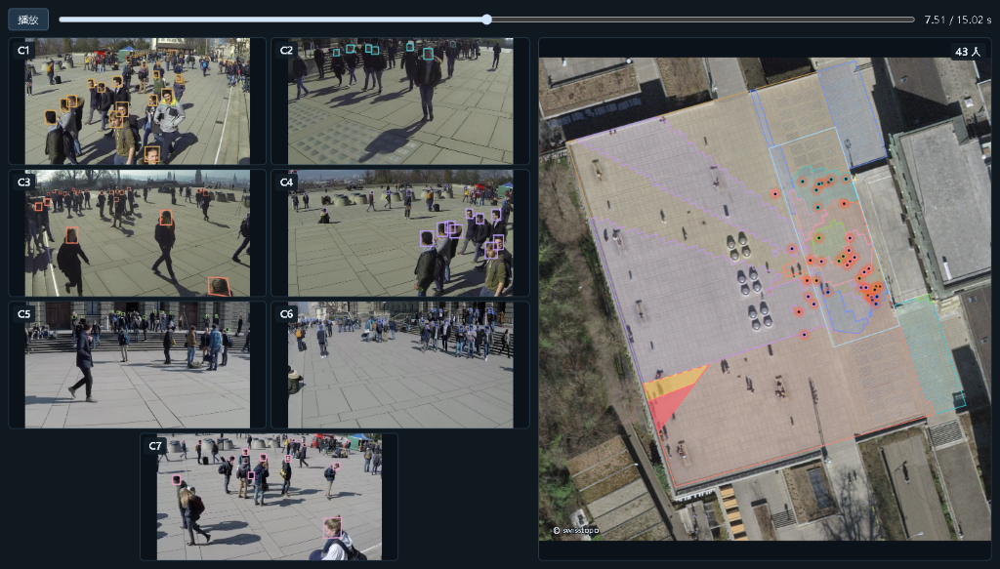
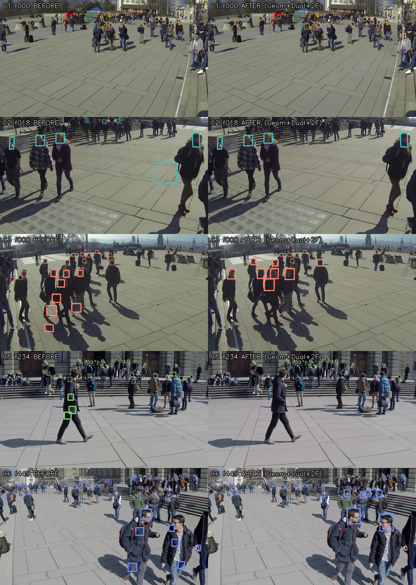

# WILDTRACK 七机位逐帧人头框同屏回放演示

本目录为可独立打开的 WILDTRACK 七机位同屏回放演示包，左侧同步播放 7 路独立的逐帧带人头框视频（`video-head/C1.mp4`～`C7.mp4`），右侧保留既有的 7 路固定主区脚点汇总热力地图（`replay-data.js`）。

## 快速打开

- 直接双击打开 [`index.html`](index.html)，或在目录内启动任意静态服务（如 `python -m http.server 8765`）后访问 `index.html`。
- 左侧 7 路视频与右侧地图共用顶部播放/暂停、进度条与时间显示；地图按每 0.5 秒（`15 / (30000/1001) s`）刷新。

## 口径说明（避免误解）

- **左侧七路视频**：来自 WILDTRACK 850～995 帧窗口对应的 7 路 640×360、约 29.97 FPS（`30000/1001`）、每路 450 帧（15.015 s）独立 MP4，已将逐帧人头检测框直接绘制进对应视频帧。
- **右侧汇总热力与总人数**：沿用既有 `replay-data.js`（每 0.5 秒共 30 个采样点，基于固定主区分配的 YOLOX 行人框脚点投影汇总）。本轮仅修复左侧回放叠框与误检，**未改动右侧汇总计数逻辑**；左右两侧按同一时间轴同步，右侧人数不由左侧人头框直接求和得到。
- **航拍底图**：`polyterrasse-close.jpg` 来自瑞士联邦测绘局（`© swisstopo`，画面左下角保留署名）。

---

## 实验历程

### 1. 问题起点：0.5 秒 SVG 叠框滞后
初版同屏页面在左侧 7 个 `<video>` 上叠加 SVG 层，数据来自 2 Hz 采样的 `head-wall-data.js`（每 0.5 秒换一组框）。视频以 29.97 FPS 连续播放时，移动行人的框会停留在旧位置，出现明显拖影与脱节。

### 2. 第一版修复：逐帧去畸变检测与原画幅回投
- 编写 [`render_head_videos.py`](render_head_videos.py)，直接读取实际播放的 7 路 450 帧视频，逐帧映射到 1920×1080 标定坐标系并用各机位原始内参/畸变参数去畸变。
- `C2` 沿用原版 YOLOv8s-Head 640，其余 6 路沿用模型二 640，按 `protocol.json` 推理配置逐帧检测人头。
- 复用 8 点多边形镜头回投（`cv2.projectPoints`）及与 `cv2.remap` 的 `≤ 0.5 px` 一致性校验，将去畸变框准确画回 640×360 原画幅（远景小框自适应 1 px 细线，近景大框 2 px），并用 H.264 (`yuv420p`、`-g 15`、`+faststart`) 分别编码输出至 `video-head/C1.mp4`～`C7.mp4`。
- **结果**：框已完全跟随行人逐帧移动，但视觉复检暴露出明显的**非人头误检 / 一人多框**问题。

### 3. 误检根因诊断：模型二近景尺度偏移
对 `C1 / C2 / C3 / C5 / C6` 问题帧做双模型与置信度抽检，定位到两类根因：
1. **模型二近景尺度偏移（主因）**：模型二经高密度小人头微调后，远景小人头召回强，但在近景遇到大尺寸行人时容易漏掉大头，反而把深色外套、衣袋、手肘、膝盖、背包切成多个约 `20×20 px` 的高分误框（例如 `C5 f234` 步行男子大腿 `0.621`、`C6 f449` 腿部 `0.508 / 0.592`）。同一帧下**原版 YOLOv8s-Head** 在近景零身体误框且能高分框正真头（`C6 f449` 两位前景行人 `0.855 / 0.761`）。
2. **单帧背景闪烁（次因）**：例如 `C2 f018` 地砖缝偶发出现 `78×64 px` 低分框（`0.274`）。

仅提高 `conf` 阈值无法同时兼顾远景小人头召回与近景高分身体误检消除。

### 4. 第二版优化（当前交付版）：三段式去误检
在不重新训练权重、不改右侧地图逻辑的前提下，在 [`render_head_videos.py`](render_head_videos.py) 中集成三段过滤：
1. **标定几何尺度过滤**：利用 7 路已验证内外参，按头高 `z = 1.65 m`（高台/台阶回退 `2.8 m`）反算每帧候选框中心处真实人头（直径约 `0.25 m`）的预期像素尺寸 `d_exp`，仅保留 `0.52×d_exp ≤ size ≤ 1.85×d_exp`、非边缘长宽比 `0.38～1.9` 且 `conf ≥ 0.30` 的框，直接剔除物理尺度不合理的近景衣裤小框与超大地面框。
2. **近远景双模型分带融合**：以 `d_exp = 66 px`（1920×1080 口径，约等于 640×360 下 `22 px`）为界，近中景使用原版 YOLOv8s-Head，远景使用模型二并保留高分原版框（`conf ≥ 0.45`），交界处按 IoU ≥ 0.40 或中心距 `< 0.45 × min(s1, s2)` 去重；`C2` 保持原版 YOLOv8s-Head。
3. **2 帧零延迟防闪烁**：离线回放采用 `[t-1, t+1]` 邻帧确认，剔除仅出现 1 帧的背景闪烁误检，且不引入帧延迟。

### 5. 量化对比与验收结果

| 机位 | 帧数（可解码） | 过滤前总框数 | 过滤后总框数 | 变化 | 复检现象 |
| --- | :---: | ---: | ---: | ---: | --- |
| C1 | 450 / 450 | 25,216 | 19,186 | -23.9% | 近景肩部/背包/裤袋误框清除，真头补齐 |
| C2 | 450 / 450 | 3,485 | 3,173 | -9.0% | 地面偶发大框清除 |
| C3 | 450 / 450 | 12,512 | 10,556 | -15.6% | 腿部与阴影误框清除，近景大头补齐 |
| C4 | 450 / 450 | 8,639 | 6,578 | -23.9% | 前景背部/背包误框清除，真头框正 |
| C5 | 450 / 450 | 17,783 | 8,187 | -54.0% | 步行男子外套/手肘/大腿多框完全清除 |
| C6 | 450 / 450 | 20,835 | 13,532 | -35.1% | 近景胸口/膝盖误框清除，两人真头完整命中 |
| C7 | 450 / 450 | 11,257 | 10,300 | -8.5% | 画面底边近景原本漏检的 3 个真头补齐 |

- **编码与解码**：7 路全部为 `640×360`、`h264 / yuv420p`、`30000/1001` FPS、时长 `15.015 s`、`450/450` 帧无损解码。详见 [`render-summary.txt`](render-summary.txt)。
- **浏览器同步实测**：验证 7 路加载无报错，**播放 → 暂停**、**继续播放 → 暂停**及**拖动进度条**（`2.47 s` / `7.51 s` / `13.98 s`）时 7 路画面与右侧热力地图及总人数保持对齐。

---

## 模型权重与交接说明

本演示同时使用以下两版权重（均不随 Git 仓库提交，核对信息见 [`../../models/MODEL_CARD.md`](../../models/MODEL_CARD.md)）：
- **原版 YOLOv8s-Head (`v8s-head.pt`)**：SHA-256 `1467b10e30a05be6a05950190e5efe30b50681270cb7baf6115ec96806b25964`（22.5 MB，AGPL-3.0）。
- **模型二 (`skyguard-yolov8s-head-round2.pt`)**：SHA-256 `48e20da23a4c645bf29d47e4da1ae0ec52b9e0220e610d96fbc8c5336ddc6e7e`（111.7 MB，超过 GitHub 单文件 100 MB 上限，已发布为 Release 附件：[直接下载](https://github.com/imsquner/skyguard-evacuation/releases/download/head-model-round2-v1/skyguard-yolov8s-head-round2.pt)）。

## 下一步计划

1. **寻找更高质量的数据集做下一版多视角演示**：筛选视角、标定与人群密度更贴合实际应用的公开/合规数据集，进一步验证人头检测与跨机位汇总效果。
2. **补足武汉江滩实景演示**：按主仓库观测回放契约接入江滩实景底图与视频流，完成最终端到端演示。
